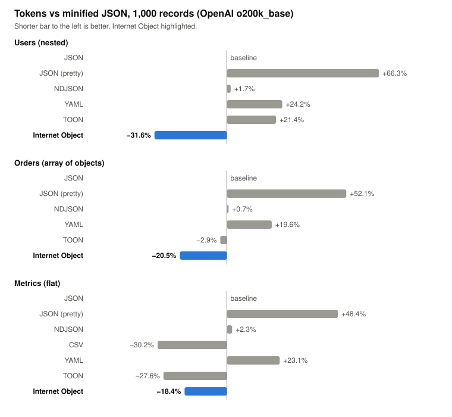
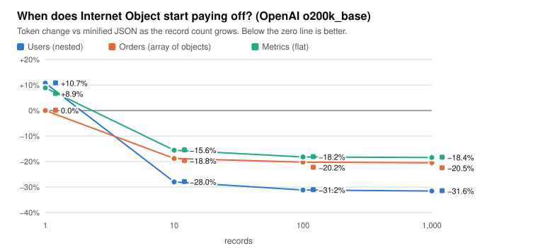
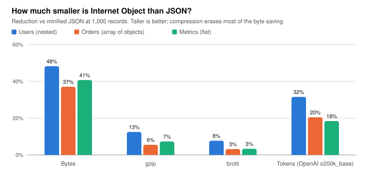
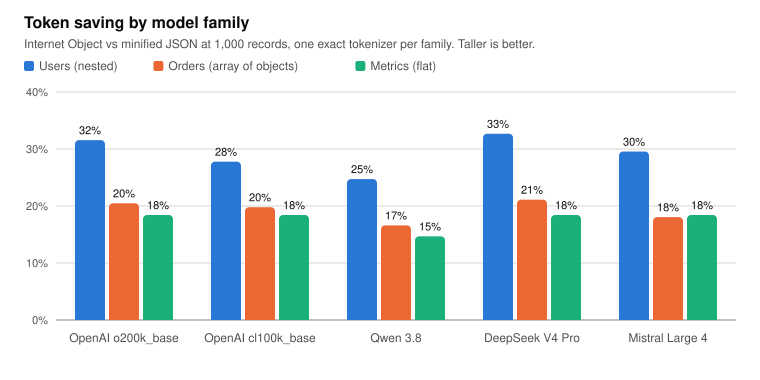
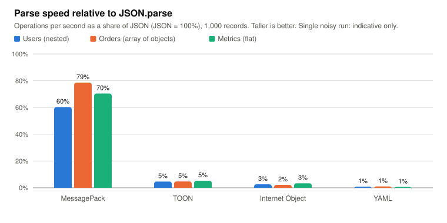
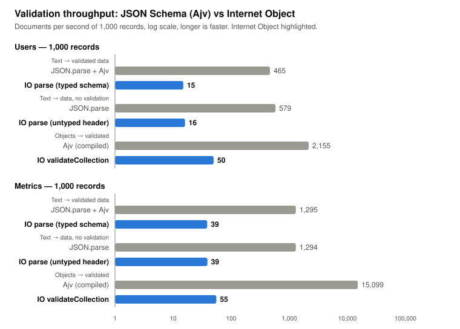

# Internet Object vs JSON — benchmark

[](https://github.com/maniartech/InternetObject-vs-JSON-benchmark/actions/workflows/ci.yml)

[](LICENSE)

A reproducible comparison of [Internet Object](https://github.com/maniartech/InternetObject-js) (IO) with JSON and other common formats. It measures **size, compression, token counts across several LLM tokenizers, and speed**, on three different data shapes.

Everything below is generated from a recorded run (`results/latest.json`), uses a fixed seed, and can be re-run with one command.

## Quick start

```sh
npm install
npm start                                      # all datasets × 1, 10, 100, 1000 records
npm start -- --counts 10,500 --datasets users  # custom run
npm run bench                                  # full run incl. speed and validation; writes results/latest.{json,md}
npm run readme                                 # refresh the tables in this README from that run
npm run charts                                 # redraw docs/charts/*.svg from that run
npm test
```

Requires Node 22+. `npm start -- --help` lists every option, `npm run list` shows the available datasets, formats and tokenizers.

## Results

### Smallest format at a glance

The winner in each column at 1,000 records (percentage is versus minified JSON). Which format wins depends on the data shape: Internet Object leads on nested data, CSV and TOON on flat tabular data.

<!-- winners:start -->
| Dataset | Bytes | gzip | OpenAI o200k_base | OpenAI cl100k_base | Qwen 3.8 | DeepSeek V4 Pro | Mistral Large 4 |
| --- | --- | --- | --- | --- | --- | --- | --- |
| Users (nested object + array) | **Internet Object** (−48.2%) | **Internet Object** (−12.5%) | **Internet Object** (−31.6%) | **Internet Object** (−27.8%) | **Internet Object** (−24.7%) | **Internet Object** (−32.7%) | **Internet Object** (−29.6%) |
| Orders (array of objects) | **Internet Object** (−37.1%) | **Internet Object** (−5.5%) | **Internet Object** (−20.5%) | **Internet Object** (−19.8%) | **Internet Object** (−16.6%) | **Internet Object** (−21.1%) | **Internet Object** (−18.0%) |
| Metrics (flat, numeric) | **CSV** (−51.0%) | **CSV** (−9.8%) | **CSV** (−30.2%) | **CSV** (−30.2%) | **CSV** (−24.0%) | **CSV** (−30.2%) | **CSV** (−30.2%) |
<!-- winners:end -->

### Charts

Generated from `results/latest.json` by `npm run charts`; they adapt to light and dark themes.

<p align="center"></p>

<p align="center"></p>

<p align="center"></p>

<p align="center"></p>

<p align="center"></p>

### Full comparison

1,000 records per dataset, minified JSON as the baseline (negative = smaller; the best value in each column is **bold**). Counts for each tokenizer are exact for that tokenizer's vocabulary; they are not interchangeable between model families.

<!-- results:start -->
<sub>Generated 2026-11-02 · seed 2026 · Node v22.22.1 · internet-object 0.3.0. Percentages are relative to minified JSON (lower is better). <b>Bold</b> marks the best (smallest) value in each column.</sub>

### Users (nested object + array) — 1,000 records

| Format | Bytes | gzip | brotli | OpenAI o200k_base | OpenAI cl100k_base | Qwen 3.8 | DeepSeek V4 Pro | Mistral Large 4 |
| --- | ---: | ---: | ---: | ---: | ---: | ---: | ---: | ---: |
| JSON | 196,913 | 40,779 | 33,149 | 59,834 | 57,383 | 64,402 | 61,653 | 59,755 |
| JSON (pretty) | 295,512 (+50.1%) | 43,677 (+7.1%) | 34,177 (+3.1%) | 99,507 (+66.3%) | 99,056 (+72.6%) | 121,461 (+88.6%) | 100,310 (+62.7%) | 101,428 (+69.7%) |
| NDJSON | 196,912 (−0.0%) | 40,777 (−0.0%) | 33,143 (−0.0%) | 60,832 (+1.7%) | 58,381 (+1.7%) | 66,400 (+3.1%) | 62,651 (+1.6%) | 60,753 (+1.7%) |
| YAML | 204,743 (+4.0%) | 40,853 (+0.2%) | 33,054 (−0.3%) | 74,285 (+24.2%) | 73,794 (+28.6%) | 82,872 (+28.7%) | 74,767 (+21.3%) | 75,530 (+26.4%) |
| TOON | 212,664 (+8.0%) | 41,391 (+1.5%) | 33,446 (+0.9%) | 72,658 (+21.4%) | 72,101 (+25.6%) | 80,139 (+24.4%) | 73,133 (+18.6%) | 73,779 (+23.5%) |
| MessagePack | 150,822 (−23.4%) | 42,139 (+3.3%) | 35,379 (+6.7%) | – | – | – | – | – |
| Internet Object | **101,925 (−48.2%)** | **35,678 (−12.5%)** | **30,583 (−7.7%)** | **40,955 (−31.6%)** | **41,444 (−27.8%)** | **48,481 (−24.7%)** | **41,507 (−32.7%)** | **42,096 (−29.6%)** |

### Orders (array of objects) — 1,000 records

| Format | Bytes | gzip | brotli | OpenAI o200k_base | OpenAI cl100k_base | Qwen 3.8 | DeepSeek V4 Pro | Mistral Large 4 |
| --- | ---: | ---: | ---: | ---: | ---: | ---: | ---: | ---: |
| JSON | 359,701 | 101,101 | 83,241 | 134,024 | 134,117 | 159,227 | 140,585 | 134,021 |
| JSON (pretty) | 567,946 (+57.9%) | 106,446 (+5.3%) | 85,701 (+3.0%) | 203,800 (+52.1%) | 204,893 (+52.8%) | 252,934 (+58.9%) | 210,332 (+49.6%) | 205,797 (+53.6%) |
| NDJSON | 359,700 (−0.0%) | 101,010 (−0.1%) | 83,325 (+0.1%) | 135,022 (+0.7%) | 135,115 (+0.7%) | 161,225 (+1.3%) | 141,583 (+0.7%) | 135,019 (+0.7%) |
| YAML | 395,504 (+10.0%) | 102,337 (+1.2%) | 83,985 (+0.9%) | 160,258 (+19.6%) | 161,212 (+20.2%) | 187,443 (+17.7%) | 169,593 (+20.6%) | 162,616 (+21.3%) |
| TOON | 308,085 (−14.3%) | 99,646 (−1.4%) | 83,280 (+0.0%) | 130,199 (−2.9%) | 130,947 (−2.4%) | 156,181 (−1.9%) | 132,518 (−5.7%) | 132,118 (−1.4%) |
| MessagePack | 305,036 (−15.2%) | 106,467 (+5.3%) | 88,220 (+6.0%) | – | – | – | – | – |
| Internet Object | **226,342 (−37.1%)** | **95,516 (−5.5%)** | **80,562 (−3.2%)** | **106,578 (−20.5%)** | **107,577 (−19.8%)** | **132,797 (−16.6%)** | **110,902 (−21.1%)** | **109,837 (−18.0%)** |

### Metrics (flat, numeric) — 1,000 records

| Format | Bytes | gzip | brotli | OpenAI o200k_base | OpenAI cl100k_base | Qwen 3.8 | DeepSeek V4 Pro | Mistral Large 4 |
| --- | ---: | ---: | ---: | ---: | ---: | ---: | ---: | ---: |
| JSON | 88,471 | 11,914 | 9,882 | 43,374 | 43,374 | 54,419 | 43,374 | 43,374 |
| JSON (pretty) | 130,472 (+47.5%) | 12,490 (+4.8%) | 10,502 (+6.3%) | 64,374 (+48.4%) | 64,374 (+48.4%) | 82,420 (+51.5%) | 64,374 (+48.4%) | 64,374 (+48.4%) |
| NDJSON | 88,470 (−0.0%) | 11,913 (−0.0%) | 9,890 (+0.1%) | 44,372 (+2.3%) | 44,372 (+2.3%) | 56,417 (+3.7%) | 44,372 (+2.3%) | 44,372 (+2.3%) |
| CSV | **43,388 (−51.0%)** | **10,752 (−9.8%)** | **9,054 (−8.4%)** | **30,279 (−30.2%)** | **30,279 (−30.2%)** | **41,377 (−24.0%)** | **30,279 (−30.2%)** | **30,279 (−30.2%)** |
| YAML | 88,470 (−0.0%) | 11,843 (−0.6%) | 9,940 (+0.6%) | 53,372 (+23.1%) | 53,372 (+23.1%) | 64,417 (+18.4%) | 53,372 (+23.1%) | 53,372 (+23.1%) |
| TOON | 50,502 (−42.9%) | 10,843 (−9.0%) | 9,322 (−5.7%) | 31,389 (−27.6%) | 31,389 (−27.6%) | 42,436 (−22.0%) | 32,389 (−25.3%) | 31,389 (−27.6%) |
| MessagePack | 72,469 (−18.1%) | 12,377 (+3.9%) | 10,737 (+8.7%) | – | – | – | – | – |
| Internet Object | 52,450 (−40.7%) | 11,042 (−7.3%) | 9,550 (−3.4%) | 35,386 (−18.4%) | 35,386 (−18.4%) | 46,432 (−14.7%) | 35,386 (−18.4%) | 35,386 (−18.4%) |
<!-- results:end -->

### How the token saving scales with record count

IO states its schema once, so the header costs tokens up front and pays off as records accumulate.

<!-- scaling:start -->
**OpenAI o200k_base** — Internet Object tokens vs minified JSON

| Dataset | 1 | 10 | 100 | 1,000 |
| --- | ---: | ---: | ---: | ---: |
| Users (nested object + array) | +10.7% | −28.0% | −31.2% | −31.6% |
| Orders (array of objects) | 0.0% | −18.8% | −20.2% | −20.5% |
| Metrics (flat, numeric) | +8.9% | −15.6% | −18.2% | −18.4% |

**OpenAI cl100k_base** — Internet Object tokens vs minified JSON

| Dataset | 1 | 10 | 100 | 1,000 |
| --- | ---: | ---: | ---: | ---: |
| Users (nested object + array) | +15.1% | −23.9% | −27.5% | −27.8% |
| Orders (array of objects) | +0.9% | −18.1% | −19.5% | −19.8% |
| Metrics (flat, numeric) | +8.9% | −15.6% | −18.2% | −18.4% |

**Qwen 3.8** — Internet Object tokens vs minified JSON

| Dataset | 1 | 10 | 100 | 1,000 |
| --- | ---: | ---: | ---: | ---: |
| Users (nested object + array) | +15.0% | −21.1% | −24.4% | −24.7% |
| Orders (array of objects) | +1.5% | −15.1% | −16.4% | −16.6% |
| Metrics (flat, numeric) | +8.9% | −12.2% | −14.5% | −14.7% |

**DeepSeek V4 Pro** — Internet Object tokens vs minified JSON

| Dataset | 1 | 10 | 100 | 1,000 |
| --- | ---: | ---: | ---: | ---: |
| Users (nested object + array) | +8.6% | −29.0% | −32.5% | −32.7% |
| Orders (array of objects) | 0.0% | −19.7% | −21.0% | −21.1% |
| Metrics (flat, numeric) | +8.9% | −15.6% | −18.2% | −18.4% |

**Mistral Large 4** — Internet Object tokens vs minified JSON

| Dataset | 1 | 10 | 100 | 1,000 |
| --- | ---: | ---: | ---: | ---: |
| Users (nested object + array) | +12.7% | −25.0% | −29.4% | −29.6% |
| Orders (array of objects) | +3.8% | −16.4% | −17.9% | −18.0% |
| Metrics (flat, numeric) | +8.9% | −15.6% | −18.2% | −18.4% |
<!-- scaling:end -->

### Validation: JSON Schema (Ajv) vs an IO schema

The same constraints (types, integer ranges, an enum, a date, a fixed-length optional field) are written once as a JSON Schema, checked with [Ajv](https://ajv.js.org) (compiled once, as in production), and once as a typed Internet Object schema. Both are proven by the test suite (`test/validation.test.js`) to accept the generated data and to reject every injected single-rule violation. Only the `users` and `metrics` datasets have schemas.

<p align="center"></p>

<!-- validation:start -->
### Validation — 1,000 Users (nested object + array) records (documents per second, higher is better)

| Scenario | Validator | Docs/sec | IO vs JSON counterpart |
| --- | --- | ---: | ---: |
| Text → validated data | JSON.parse + Ajv | 465 | – |
| Text → validated data | IO parse (typed schema) | 15 | 31.0× slower |
| Text → data, no validation | JSON.parse | 579 | – |
| Text → data, no validation | IO parse (untyped header) | 16 | 36.1× slower |
| Objects → validated | Ajv (compiled) | 2,155 | – |
| Objects → validated | IO validateCollection | 50 | 43.2× slower |

Cost of validating while reading: JSON.parse + Ajv is 1.24× the time of JSON.parse alone; IO with a typed schema is 1.07× the time of IO with an untyped header.

### Validation — 1,000 Metrics (flat, numeric) records (documents per second, higher is better)

| Scenario | Validator | Docs/sec | IO vs JSON counterpart |
| --- | --- | ---: | ---: |
| Text → validated data | JSON.parse + Ajv | 1,295 | – |
| Text → validated data | IO parse (typed schema) | 39 | 33.5× slower |
| Text → data, no validation | JSON.parse | 1,294 | – |
| Text → data, no validation | IO parse (untyped header) | 39 | 33.2× slower |
| Objects → validated | Ajv (compiled) | 15,099 | – |
| Objects → validated | IO validateCollection | 55 | 272.5× slower |

Cost of validating while reading: JSON.parse + Ajv is 1.00× the time of JSON.parse alone; IO with a typed schema is 1.01× the time of IO with an untyped header.
<!-- validation:end -->

How to read this:
- **IO validates while it parses**, so the validation itself adds little (the "cost of validating while reading" line). The gap is the parser, not the checks.
- **Ajv compiles schemas into JavaScript functions**, which is why validating already-parsed objects is dramatically faster than IO's `validateCollection`.
- **Not identical work:** IO also converts values (`date` becomes a `Date`), and its errors carry a code plus line and column. The Ajv path leaves ISO strings as strings. Throughput is documents per second, each of 1,000 records, on one noisy run.

### What the numbers say

- **Structure matters more than format.** IO is the smallest text format on the nested datasets (users, orders). On flat tabular data, CSV and TOON are smaller in tokens; the gap to IO is real in the `Metrics` table above.
- **Compression narrows the gap a lot.** Raw bytes shrink by roughly half on `users`, but after gzip/brotli the difference is single digits to low teens. If your payloads are compressed on the wire, the byte saving is mostly a token and in-memory saving, not a bandwidth one.
- **Tiny payloads don't benefit.** At 1 record, IO is roughly even with JSON or slightly worse because of the schema header.
- **Parsing is the cost.** In the speed run, the reference IO parser is much slower than `JSON.parse` (order-of-magnitude). Speed numbers are machine-dependent and noisy; run `npm run bench` on your own hardware before drawing conclusions. IO serialization here is this repo's encoder, not a library function.

## Methodology

| Aspect | Detail |
| --- | --- |
| **Data** | Three seeded datasets (`src/datasets.js`): `users` (nested object + array, the original benchmark shape), `orders` (variable-length array of objects), `metrics` (flat, numeric). Generated with [faker](https://fakerjs.dev); same seed ⇒ identical records. |
| **Baseline** | Minified `JSON.stringify` output. Pretty JSON, NDJSON, CSV (flat data only), YAML, TOON and MessagePack are shown for context. |
| **Bytes** | UTF-8 bytes of the *entire* serialized document (for IO: schema header, `---`, every `~ ` prefix and newline). The first version of this benchmark counted UTF-16 characters and omitted the `~ ` prefixes and newlines, which flattered IO by about 3%. |
| **Compression** | gzip level 9 and brotli quality 11 of the same bytes. |
| **Tokens** | Counted on the full document text per tokenizer. See below. |
| **Validity** | Before any number is reported, the generated IO is parsed with the **official `internet-object` parser** and compared to the source records. A mismatch aborts the run. |
| **Speed** | [tinybench](https://github.com/tinylibs/tinybench), serialize and parse of 1,000 records, each format using its own reference library. |

### Tokenizers

| Id | Covers | Source |
| --- | --- | --- |
| `o200k_base` | OpenAI GPT-4o, GPT-4.1 and the GPT-5 family | local ([gpt-tokenizer](https://github.com/niieani/gpt-tokenizer)) |
| `cl100k_base` | OpenAI GPT-4, GPT-3.5 | local |
| `claude:<model>` | Anthropic Claude | Anthropic `count_tokens` API — set `ANTHROPIC_API_KEY` (and optionally `ANTHROPIC_MODEL`) |
| `qwen3.8`, `deepseek-v4-pro`, `mistral-large-4` | Open-weight families (Qwen 3.8, DeepSeek V4 Pro, Mistral Large 4) | tokenizer files from Hugging Face, cached in `node_modules/.cache` (`HF_TOKEN` for gated repos) |

Adding another is a few lines in [`src/tokenizers.js`](src/tokenizers.js). The npm `@anthropic-ai/tokenizer` package is deliberately not used: it only matches Claude 2. Remote counts are cached in `results/token-cache.json` so they are only paid for once and can be committed. Tokenizers that can't be loaded (no key, offline) are skipped and listed as unavailable rather than failing the run.

Cost is intentionally not computed: list prices change often. Multiply token counts by your current price per million tokens.

## Internet Object format notes

Writing IO correctly by hand is subtler than it looks. Checking against the official parser surfaced rules this benchmark's encoder (`src/io/encode.js`) has to follow, and a few parser behaviours worth knowing:

- Strings containing `'` must be quoted — `O'Neil` is read as an annotation and fails. The original version of this benchmark emitted such names bare, so its sample data was not valid IO.
- Only uppercase `T`/`F` are booleans; lowercase `f`/`m` stay strings.
- Strings that look like numbers (`1e5`, `0x1F`) or other literals (`Inf`, `null`) need quotes.
- Single-letter booleans/null are uppercase `T`/`F`/`N`; numeric lookalikes such as `1e5`, `0x1F` and `Inf` are read as numbers (or null) unless quoted.
- `internet-object` 0.2.1 silently dropped a trailing letter after digits (`4912808N` read back as `4912808`). That is fixed in 0.3.0, which this benchmark uses; the encoder no longer quotes those strings.

### Which Internet Object version?

This benchmark uses **`internet-object` 0.3.0**, built from [InternetObject-js](https://github.com/maniartech/InternetObject-js) commit `b6859d6` and vendored as `vendor/internet-object-0.3.0-b6859d6.tgz`. 0.3.0 is not published to npm yet (the `latest` tag is still 0.2.1), and the repository does not commit its `dist/`, so a plain git dependency would not install. Once 0.3.0 is on npm, replace the vendored tarball with `npm install internet-object@0.3.0`. The format is unchanged from 0.2.1, so sizes and token counts are identical; only the parse API and speed differ.

## Project layout

```
index.js                 CLI
src/
  datasets.js            seeded data shapes + their IO schemas
  formats.js             serializers / parsers per format
  tokenizers.js          tokenizer adapters (OpenAI, Anthropic, Hugging Face)
  io/                    IO encoder and parser loading
  verify.js              IO round-trip check
  run.js  report.js  speed.js  validation.js
scripts/update-readme.js regenerates the tables above
scripts/make-charts.js   draws docs/charts/*.svg
docs/charts/             chart SVGs used in this README
vendor/                  pinned internet-object 0.3.0 tarball
results/                 latest.json / latest.md from the last recorded run
data/                    sample output, 100 records per format (npm start -- --save-data data)
test/                    node:test suite
```

## Limitations

- Three synthetic datasets. Real payloads (long free text, sparse fields, deep nesting) will behave differently; add a dataset in `src/datasets.js` to test yours.
- Token counts show how many tokens a model *reads*, not how well it *understands* the format. An accuracy evaluation is not included.
- The IO schema header can also carry types and validation, which the other formats here don't have; this benchmark only compares size and speed.

## Questions

Email <hello@internetobject.org> or open an [issue](https://github.com/maniartech/InternetObject-vs-JSON-benchmark/issues).

## License

[ISC](LICENSE)
