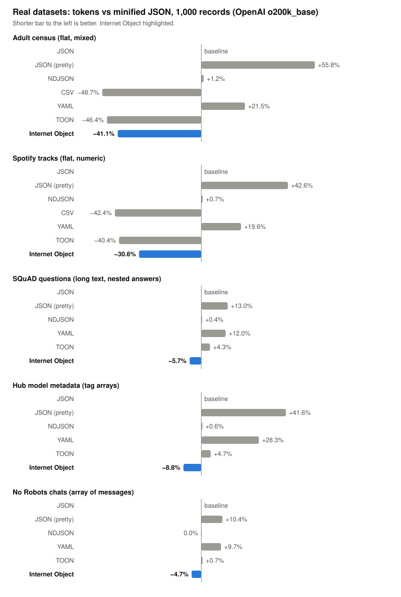

# Internet Object vs JSON — benchmark

[](https://github.com/maniartech/InternetObject-vs-JSON-benchmark/actions/workflows/ci.yml)

[](LICENSE)

A reproducible comparison of [Internet Object](https://github.com/maniartech/InternetObject-js) (IO) with JSON and other common formats. It measures **size, compression, and token counts across several LLM tokenizers**, on synthetic and real-world data. Parse speed is deliberately left out for now: the JavaScript implementation is still under development, so this benchmark is about what the *format* costs, not how fast one parser reads it.

Everything below is generated from a recorded run (`results/latest.json`), uses a fixed seed, and can be re-run with one command.

## Quick start

```sh
npm install
npm start                                      # all datasets × 1, 10, 100, 1000 records
npm start -- --counts 10,500 --datasets users  # custom run
npm run bench                                  # full run; writes results/latest.{json,md}
npm run readme                                 # refresh the tables in this README from that run
npm run charts                                 # redraw docs/charts/*.svg from that run
npm run fetch-data                             # download the real Hugging Face datasets (optional; do this first)
npm test
```

Requires Node 22+. `npm start -- --help` lists every option, `npm run list` shows the available datasets, formats and tokenizers.

## Results

### Smallest format at a glance

The winner in each column at 1,000 records (percentage is versus minified JSON). Which format wins depends on the data shape: Internet Object leads on nested data, and CSV leads on flat tables (where TOON is a close second). On real, text-heavy data the winner is still Internet Object, but by single digits.

<!-- winners:start -->
| Dataset | Bytes | gzip | OpenAI o200k_base | OpenAI cl100k_base | Qwen 3.8 | DeepSeek V4 Pro | Mistral Large 4 |
| --- | --- | --- | --- | --- | --- | --- | --- |
| Users (nested object + array) | **Internet Object** (−48.2%) | **Internet Object** (−12.5%) | **Internet Object** (−31.6%) | **Internet Object** (−27.8%) | **Internet Object** (−24.7%) | **Internet Object** (−32.7%) | **Internet Object** (−29.6%) |
| Orders (array of objects) | **Internet Object** (−37.1%) | **Internet Object** (−5.5%) | **Internet Object** (−20.5%) | **Internet Object** (−19.8%) | **Internet Object** (−16.6%) | **Internet Object** (−21.1%) | **Internet Object** (−18.0%) |
| Metrics (flat, numeric) | **CSV** (−51.0%) | **CSV** (−9.8%) | **CSV** (−30.2%) | **CSV** (−30.2%) | **CSV** (−24.0%) | **CSV** (−30.2%) | **CSV** (−30.2%) |
| Adult census (flat, mixed) | **CSV** (−64.7%) | **CSV** (−14.3%) | **CSV** (−48.7%) | **CSV** (−48.4%) | **CSV** (−43.6%) | **CSV** (−51.2%) | **CSV** (−47.2%) |
| Spotify tracks (flat, numeric) | **CSV** (−61.4%) | **CSV** (−17.3%) | **CSV** (−42.4%) | **CSV** (−41.2%) | **CSV** (−35.2%) | **CSV** (−44.5%) | **CSV** (−42.4%) |
| SQuAD questions (long text, nested answers) | **Internet Object** (−6.3%) | **Internet Object** (−1.0%) | **Internet Object** (−5.7%) | **Internet Object** (−4.9%) | **Internet Object** (−4.2%) | **Internet Object** (−6.0%) | **Internet Object** (−4.2%) |
| Hub model metadata (tag arrays) | **Internet Object** (−20.7%) | **Internet Object** (−6.6%) | **Internet Object** (−8.8%) | **Internet Object** (−7.6%) | **Internet Object** (−5.9%) | **Internet Object** (−11.5%) | **Internet Object** (−8.8%) |
| No Robots chats (array of messages) | **Internet Object** (−5.5%) | **Internet Object** (−0.7%) | **Internet Object** (−4.7%) | **Internet Object** (−4.4%) | **Internet Object** (−3.9%) | **Internet Object** (−5.5%) | **Internet Object** (−3.9%) |
<!-- winners:end -->

### Charts

Generated from `results/latest.json` by `npm run charts`; they adapt to light and dark themes.

<p align="center"></p>

<p align="center"></p>

<p align="center"></p>

<p align="center"></p>

### Full comparison

1,000 records per dataset, minified JSON as the baseline (negative = smaller; the best value in each column is **bold**). Counts for each tokenizer are exact for that tokenizer's vocabulary; they are not interchangeable between model families.

<!-- results:start -->
<sub>Generated 2026-11-02 · seed 2026 · Node v22.22.1 · internet-object 0.3.0. Percentages are relative to minified JSON (lower is better). <b>Bold</b> marks the best (smallest) value in each column.</sub>

### Users (nested object + array) — 1,000 records

| Format | Bytes | gzip | brotli | OpenAI o200k_base | OpenAI cl100k_base | Qwen 3.8 | DeepSeek V4 Pro | Mistral Large 4 |
| --- | ---: | ---: | ---: | ---: | ---: | ---: | ---: | ---: |
| JSON | 196,913 | 40,779 | 33,149 | 59,834 | 57,383 | 64,402 | 61,653 | 59,755 |
| JSON (pretty) | 295,512 (+50.1%) | 43,677 (+7.1%) | 34,177 (+3.1%) | 99,507 (+66.3%) | 99,056 (+72.6%) | 121,461 (+88.6%) | 100,310 (+62.7%) | 101,428 (+69.7%) |
| NDJSON | 196,912 (−0.0%) | 40,777 (−0.0%) | 33,143 (−0.0%) | 60,832 (+1.7%) | 58,381 (+1.7%) | 66,400 (+3.1%) | 62,651 (+1.6%) | 60,753 (+1.7%) |
| YAML | 204,743 (+4.0%) | 40,853 (+0.2%) | 33,054 (−0.3%) | 74,285 (+24.2%) | 73,794 (+28.6%) | 82,872 (+28.7%) | 74,767 (+21.3%) | 75,530 (+26.4%) |
| TOON | 212,664 (+8.0%) | 41,391 (+1.5%) | 33,446 (+0.9%) | 72,658 (+21.4%) | 72,101 (+25.6%) | 80,139 (+24.4%) | 73,133 (+18.6%) | 73,779 (+23.5%) |
| MessagePack | 150,822 (−23.4%) | 42,139 (+3.3%) | 35,379 (+6.7%) | – | – | – | – | – |
| Internet Object | **101,925 (−48.2%)** | **35,678 (−12.5%)** | **30,583 (−7.7%)** | **40,955 (−31.6%)** | **41,444 (−27.8%)** | **48,481 (−24.7%)** | **41,507 (−32.7%)** | **42,096 (−29.6%)** |

### Orders (array of objects) — 1,000 records

| Format | Bytes | gzip | brotli | OpenAI o200k_base | OpenAI cl100k_base | Qwen 3.8 | DeepSeek V4 Pro | Mistral Large 4 |
| --- | ---: | ---: | ---: | ---: | ---: | ---: | ---: | ---: |
| JSON | 359,701 | 101,101 | 83,241 | 134,024 | 134,117 | 159,227 | 140,585 | 134,021 |
| JSON (pretty) | 567,946 (+57.9%) | 106,446 (+5.3%) | 85,701 (+3.0%) | 203,800 (+52.1%) | 204,893 (+52.8%) | 252,934 (+58.9%) | 210,332 (+49.6%) | 205,797 (+53.6%) |
| NDJSON | 359,700 (−0.0%) | 101,010 (−0.1%) | 83,325 (+0.1%) | 135,022 (+0.7%) | 135,115 (+0.7%) | 161,225 (+1.3%) | 141,583 (+0.7%) | 135,019 (+0.7%) |
| YAML | 395,504 (+10.0%) | 102,337 (+1.2%) | 83,985 (+0.9%) | 160,258 (+19.6%) | 161,212 (+20.2%) | 187,443 (+17.7%) | 169,593 (+20.6%) | 162,616 (+21.3%) |
| TOON | 308,085 (−14.3%) | 99,646 (−1.4%) | 83,280 (+0.0%) | 130,199 (−2.9%) | 130,947 (−2.4%) | 156,181 (−1.9%) | 132,518 (−5.7%) | 132,118 (−1.4%) |
| MessagePack | 305,036 (−15.2%) | 106,467 (+5.3%) | 88,220 (+6.0%) | – | – | – | – | – |
| Internet Object | **226,342 (−37.1%)** | **95,516 (−5.5%)** | **80,562 (−3.2%)** | **106,578 (−20.5%)** | **107,577 (−19.8%)** | **132,797 (−16.6%)** | **110,902 (−21.1%)** | **109,837 (−18.0%)** |

### Metrics (flat, numeric) — 1,000 records

| Format | Bytes | gzip | brotli | OpenAI o200k_base | OpenAI cl100k_base | Qwen 3.8 | DeepSeek V4 Pro | Mistral Large 4 |
| --- | ---: | ---: | ---: | ---: | ---: | ---: | ---: | ---: |
| JSON | 88,471 | 11,914 | 9,882 | 43,374 | 43,374 | 54,419 | 43,374 | 43,374 |
| JSON (pretty) | 130,472 (+47.5%) | 12,490 (+4.8%) | 10,502 (+6.3%) | 64,374 (+48.4%) | 64,374 (+48.4%) | 82,420 (+51.5%) | 64,374 (+48.4%) | 64,374 (+48.4%) |
| NDJSON | 88,470 (−0.0%) | 11,913 (−0.0%) | 9,890 (+0.1%) | 44,372 (+2.3%) | 44,372 (+2.3%) | 56,417 (+3.7%) | 44,372 (+2.3%) | 44,372 (+2.3%) |
| CSV | **43,388 (−51.0%)** | **10,752 (−9.8%)** | **9,054 (−8.4%)** | **30,279 (−30.2%)** | **30,279 (−30.2%)** | **41,377 (−24.0%)** | **30,279 (−30.2%)** | **30,279 (−30.2%)** |
| YAML | 88,470 (−0.0%) | 11,843 (−0.6%) | 9,940 (+0.6%) | 53,372 (+23.1%) | 53,372 (+23.1%) | 64,417 (+18.4%) | 53,372 (+23.1%) | 53,372 (+23.1%) |
| TOON | 50,502 (−42.9%) | 10,843 (−9.0%) | 9,322 (−5.7%) | 31,389 (−27.6%) | 31,389 (−27.6%) | 42,436 (−22.0%) | 32,389 (−25.3%) | 31,389 (−27.6%) |
| MessagePack | 72,469 (−18.1%) | 12,377 (+3.9%) | 10,737 (+8.7%) | – | – | – | – | – |
| Internet Object | 52,450 (−40.7%) | 11,042 (−7.3%) | 9,550 (−3.4%) | 35,386 (−18.4%) | 35,386 (−18.4%) | 46,432 (−14.7%) | 35,386 (−18.4%) | 35,386 (−18.4%) |
<!-- results:end -->

### How the token saving scales with record count

IO states its schema once, so the header costs tokens up front and pays off as records accumulate.

<!-- scaling:start -->
**OpenAI o200k_base** — Internet Object tokens vs minified JSON

| Dataset | 1 | 10 | 100 | 1,000 |
| --- | ---: | ---: | ---: | ---: |
| Users (nested object + array) | +10.7% | −28.0% | −31.2% | −31.6% |
| Orders (array of objects) | 0.0% | −18.8% | −20.2% | −20.5% |
| Metrics (flat, numeric) | +8.9% | −15.6% | −18.2% | −18.4% |
| Adult census (flat, mixed) | +2.4% | −36.1% | −40.4% | −41.1% |
| Spotify tracks (flat, numeric) | +5.8% | −27.1% | −30.1% | −30.6% |
| SQuAD questions (long text, nested answers) | +0.4% | −4.2% | −5.0% | −5.7% |
| Hub model metadata (tag arrays) | +1.1% | −7.9% | −10.0% | −8.8% |
| No Robots chats (array of messages) | −1.1% | −2.8% | −4.5% | −4.7% |

**OpenAI cl100k_base** — Internet Object tokens vs minified JSON

| Dataset | 1 | 10 | 100 | 1,000 |
| --- | ---: | ---: | ---: | ---: |
| Users (nested object + array) | +15.1% | −23.9% | −27.5% | −27.8% |
| Orders (array of objects) | +0.9% | −18.1% | −19.5% | −19.8% |
| Metrics (flat, numeric) | +8.9% | −15.6% | −18.2% | −18.4% |
| Adult census (flat, mixed) | +1.2% | −36.3% | −40.5% | −41.0% |
| Spotify tracks (flat, numeric) | +5.0% | −26.0% | −28.9% | −29.2% |
| SQuAD questions (long text, nested answers) | +0.9% | −3.8% | −4.6% | −4.9% |
| Hub model metadata (tag arrays) | +0.6% | −6.7% | −8.6% | −7.6% |
| No Robots chats (array of messages) | −0.7% | −2.6% | −4.2% | −4.4% |

**Qwen 3.8** — Internet Object tokens vs minified JSON

| Dataset | 1 | 10 | 100 | 1,000 |
| --- | ---: | ---: | ---: | ---: |
| Users (nested object + array) | +15.0% | −21.1% | −24.4% | −24.7% |
| Orders (array of objects) | +1.5% | −15.1% | −16.4% | −16.6% |
| Metrics (flat, numeric) | +8.9% | −12.2% | −14.5% | −14.7% |
| Adult census (flat, mixed) | +2.1% | −32.6% | −36.4% | −36.9% |
| Spotify tracks (flat, numeric) | +4.8% | −22.1% | −24.7% | −25.0% |
| SQuAD questions (long text, nested answers) | +2.0% | −3.2% | −3.8% | −4.2% |
| Hub model metadata (tag arrays) | +2.0% | −5.1% | −6.7% | −5.9% |
| No Robots chats (array of messages) | +0.3% | −2.3% | −3.7% | −3.9% |

**DeepSeek V4 Pro** — Internet Object tokens vs minified JSON

| Dataset | 1 | 10 | 100 | 1,000 |
| --- | ---: | ---: | ---: | ---: |
| Users (nested object + array) | +8.6% | −29.0% | −32.5% | −32.7% |
| Orders (array of objects) | 0.0% | −19.7% | −21.0% | −21.1% |
| Metrics (flat, numeric) | +8.9% | −15.6% | −18.2% | −18.4% |
| Adult census (flat, mixed) | 0.0% | −40.0% | −44.5% | −45.2% |
| Spotify tracks (flat, numeric) | +0.7% | −30.0% | −32.7% | −33.1% |
| SQuAD questions (long text, nested answers) | 0.0% | −4.9% | −5.7% | −6.0% |
| Hub model metadata (tag arrays) | −2.2% | −10.2% | −12.9% | −11.5% |
| No Robots chats (array of messages) | −1.4% | −3.2% | −5.2% | −5.5% |

**Mistral Large 4** — Internet Object tokens vs minified JSON

| Dataset | 1 | 10 | 100 | 1,000 |
| --- | ---: | ---: | ---: | ---: |
| Users (nested object + array) | +12.7% | −25.0% | −29.4% | −29.6% |
| Orders (array of objects) | +3.8% | −16.4% | −17.9% | −18.0% |
| Metrics (flat, numeric) | +8.9% | −15.6% | −18.2% | −18.4% |
| Adult census (flat, mixed) | +4.8% | −35.7% | −39.1% | −39.2% |
| Spotify tracks (flat, numeric) | +4.2% | −28.1% | −31.0% | −31.3% |
| SQuAD questions (long text, nested answers) | +1.3% | −3.5% | −4.1% | −4.2% |
| Hub model metadata (tag arrays) | +1.7% | −7.8% | −10.0% | −8.8% |
| No Robots chats (array of messages) | −0.3% | −2.3% | −3.8% | −3.9% |
<!-- scaling:end -->

### Real-world datasets (Hugging Face)

Synthetic data is easy to flatter, so the benchmark also runs on real records from the [Hugging Face Hub](https://huggingface.co/datasets). They are fetched on demand (`npm run fetch-data`, 1,000 rows each) and are not stored in this repository because their licences differ (one is non-commercial). Rows containing a null are skipped so every record has the same shape; the Internet Object schema header is inferred from the data, and the output still has to round-trip through the official parser.

<!-- sources:start -->
| Id | Hugging Face dataset | Licence | Revision | Notes |
| --- | --- | --- | --- | --- |
| `adult` | [scikit-learn/adult-census-income](https://huggingface.co/datasets/scikit-learn/adult-census-income) | cc0-1.0 | `fbeef6ec` | – |
| `spotify` | [maharshipandya/spotify-tracks-dataset](https://huggingface.co/datasets/maharshipandya/spotify-tracks-dataset) | bsd | `635b034f` | – |
| `squad` | [rajpurkar/squad](https://huggingface.co/datasets/rajpurkar/squad) | cc-by-sa-4.0 | `7b6d24c4` | 8 rows dropped: IO cannot write strings starting with `$`/`@` |
| `hub-models` | [cfahlgren1/hub-stats](https://huggingface.co/datasets/cfahlgren1/hub-stats) | apache-2.0 | `d398264a` | live snapshot, ordered by trending score; changes daily |
| `no-robots` | [HuggingFaceH4/no_robots](https://huggingface.co/datasets/HuggingFaceH4/no_robots) | cc-by-nc-4.0 | `e6f9a4ac` | – |
<!-- sources:end -->

<p align="center"></p>

<!-- results-real:start -->
<sub>Generated 2026-11-02 · seed 2026 · Node v22.22.1 · internet-object 0.3.0. Percentages are relative to minified JSON (lower is better). <b>Bold</b> marks the best (smallest) value in each column.</sub>

### Adult census (flat, mixed) — 1,000 records

| Format | Bytes | gzip | brotli | OpenAI o200k_base | OpenAI cl100k_base | Qwen 3.8 | DeepSeek V4 Pro | Mistral Large 4 |
| --- | ---: | ---: | ---: | ---: | ---: | ---: | ---: | ---: |
| JSON | 318,129 | 14,994 | 12,147 | 86,396 | 87,133 | 96,706 | 94,400 | 88,993 |
| JSON (pretty) | 414,130 (+30.2%) | 15,876 (+5.9%) | 12,636 (+4.0%) | 134,601 (+55.8%) | 135,338 (+55.3%) | 161,912 (+67.4%) | 142,400 (+50.8%) | 137,280 (+54.3%) |
| NDJSON | 318,128 (−0.0%) | 14,991 (−0.0%) | 12,138 (−0.1%) | 87,393 (+1.2%) | 88,130 (+1.1%) | 98,703 (+2.1%) | 94,398 (−0.0%) | 89,991 (+1.1%) |
| CSV | **112,284 (−64.7%)** | **12,847 (−14.3%)** | **10,816 (−11.0%)** | **44,341 (−48.7%)** | **44,927 (−48.4%)** | **54,500 (−43.6%)** | **46,083 (−51.2%)** | **46,987 (−47.2%)** |
| YAML | 314,716 (−1.1%) | 15,101 (+0.7%) | 12,096 (−0.4%) | 104,955 (+21.5%) | 105,471 (+21.0%) | 115,758 (+19.7%) | 110,467 (+17.0%) | 108,185 (+21.6%) |
| TOON | 114,292 (−64.1%) | 12,888 (−14.0%) | 10,878 (−10.4%) | 46,345 (−46.4%) | 46,931 (−46.1%) | 56,506 (−41.6%) | 47,087 (−50.1%) | 48,991 (−44.9%) |
| MessagePack | 258,397 (−18.8%) | 14,272 (−4.8%) | 12,133 (−0.1%) | – | – | – | – | – |
| Internet Object | 128,302 (−59.7%) | 13,173 (−12.1%) | 10,993 (−9.5%) | 50,915 (−41.1%) | 51,431 (−41.0%) | 61,006 (−36.9%) | 51,718 (−45.2%) | 54,145 (−39.2%) |

### Spotify tracks (flat, numeric) — 1,000 records

| Format | Bytes | gzip | brotli | OpenAI o200k_base | OpenAI cl100k_base | Qwen 3.8 | DeepSeek V4 Pro | Mistral Large 4 |
| --- | ---: | ---: | ---: | ---: | ---: | ---: | ---: | ---: |
| JSON | 419,546 | 88,339 | 66,728 | 145,015 | 144,405 | 168,962 | 152,190 | 147,364 |
| JSON (pretty) | 545,547 (+30.0%) | 91,229 (+3.3%) | 68,152 (+2.1%) | 206,772 (+42.6%) | 207,363 (+43.6%) | 253,918 (+50.3%) | 212,952 (+39.9%) | 210,343 (+42.7%) |
| NDJSON | 419,545 (−0.0%) | 88,340 (+0.0%) | 66,741 (+0.0%) | 146,012 (+0.7%) | 145,402 (+0.7%) | 170,959 (+1.2%) | 152,188 (−0.0%) | 148,362 (+0.7%) |
| CSV | **162,040 (−61.4%)** | **73,069 (−17.3%)** | **61,013 (−8.6%)** | **83,468 (−42.4%)** | **84,928 (−41.2%)** | **109,458 (−35.2%)** | **84,509 (−44.5%)** | **84,860 (−42.4%)** |
| YAML | 427,651 (+1.9%) | 88,520 (+0.2%) | 66,843 (+0.2%) | 173,370 (+19.6%) | 173,949 (+20.5%) | 198,777 (+17.6%) | 174,493 (+14.7%) | 174,894 (+18.7%) |
| TOON | 169,014 (−59.7%) | 73,953 (−16.3%) | 61,418 (−8.0%) | 86,386 (−40.4%) | 87,844 (−39.2%) | 112,381 (−33.5%) | 87,432 (−42.6%) | 87,777 (−40.4%) |
| MessagePack | 378,679 (−9.7%) | 104,939 (+18.8%) | 79,826 (+19.6%) | – | – | – | – | – |
| Internet Object | 184,441 (−56.0%) | 75,300 (−14.8%) | 62,190 (−6.8%) | 100,683 (−30.6%) | 102,251 (−29.2%) | 126,783 (−25.0%) | 101,807 (−33.1%) | 101,204 (−31.3%) |

### SQuAD questions (long text, nested answers) — 1,000 records

| Format | Bytes | gzip | brotli | OpenAI o200k_base | OpenAI cl100k_base | Qwen 3.8 | DeepSeek V4 Pro | Mistral Large 4 |
| --- | ---: | ---: | ---: | ---: | ---: | ---: | ---: | ---: |
| JSON | 1,084,908 | 85,484 | 61,832 | 246,098 | 249,572 | 269,627 | 254,694 | 252,428 |
| JSON (pretty) | 1,173,909 (+8.2%) | 86,591 (+1.3%) | 62,476 (+1.0%) | 278,103 (+13.0%) | 282,529 (+13.2%) | 315,578 (+17.0%) | 283,747 (+11.4%) | 286,376 (+13.4%) |
| NDJSON | 1,084,907 (−0.0%) | 85,485 (+0.0%) | 61,781 (−0.1%) | 247,095 (+0.4%) | 250,569 (+0.4%) | 271,624 (+0.7%) | 254,692 (−0.0%) | 253,425 (+0.4%) |
| YAML | 1,137,106 (+4.8%) | 88,758 (+3.8%) | 65,102 (+5.3%) | 275,547 (+12.0%) | 280,997 (+12.6%) | 307,437 (+14.0%) | 281,846 (+10.7%) | 286,147 (+13.4%) |
| TOON | 1,100,510 (+1.4%) | 86,132 (+0.8%) | 62,301 (+0.8%) | 256,639 (+4.3%) | 261,872 (+4.9%) | 285,109 (+5.7%) | 263,084 (+3.3%) | 266,524 (+5.6%) |
| MessagePack | 1,053,860 (−2.9%) | 88,108 (+3.1%) | 63,830 (+3.2%) | – | – | – | – | – |
| Internet Object | **1,017,007 (−6.3%)** | **84,647 (−1.0%)** | **61,407 (−0.7%)** | **232,075 (−5.7%)** | **237,297 (−4.9%)** | **258,355 (−4.2%)** | **239,381 (−6.0%)** | **241,914 (−4.2%)** |

### Hub model metadata (tag arrays) — 1,000 records

| Format | Bytes | gzip | brotli | OpenAI o200k_base | OpenAI cl100k_base | Qwen 3.8 | DeepSeek V4 Pro | Mistral Large 4 |
| --- | ---: | ---: | ---: | ---: | ---: | ---: | ---: | ---: |
| JSON | 537,135 | 104,863 | 67,199 | 180,114 | 179,913 | 201,823 | 189,419 | 182,421 |
| JSON (pretty) | 752,391 (+40.1%) | 114,401 (+9.1%) | 70,084 (+4.3%) | 255,043 (+41.6%) | 255,842 (+42.2%) | 311,218 (+54.2%) | 262,349 (+38.5%) | 258,351 (+41.6%) |
| NDJSON | 537,134 (−0.0%) | 104,856 (−0.0%) | 67,257 (+0.1%) | 181,111 (+0.6%) | 180,910 (+0.6%) | 203,820 (+1.0%) | 189,417 (−0.0%) | 183,419 (+0.5%) |
| YAML | 615,996 (+14.7%) | 108,896 (+3.8%) | 68,481 (+1.9%) | 231,105 (+28.3%) | 232,091 (+29.0%) | 255,698 (+26.7%) | 233,902 (+23.5%) | 233,777 (+28.2%) |
| TOON | 522,276 (−2.8%) | 105,868 (+1.0%) | 68,745 (+2.3%) | 188,504 (+4.7%) | 188,956 (+5.0%) | 215,470 (+6.8%) | 193,583 (+2.2%) | 191,633 (+5.0%) |
| MessagePack | 461,077 (−14.2%) | 110,609 (+5.5%) | 73,515 (+9.4%) | – | – | – | – | – |
| Internet Object | **425,919 (−20.7%)** | **97,922 (−6.6%)** | **65,443 (−2.6%)** | **164,323 (−8.8%)** | **166,294 (−7.6%)** | **189,892 (−5.9%)** | **167,623 (−11.5%)** | **166,310 (−8.8%)** |

### No Robots chats (array of messages) — 1,000 records

| Format | Bytes | gzip | brotli | OpenAI o200k_base | OpenAI cl100k_base | Qwen 3.8 | DeepSeek V4 Pro | Mistral Large 4 |
| --- | ---: | ---: | ---: | ---: | ---: | ---: | ---: | ---: |
| JSON | 1,427,757 | 550,392 | 425,637 | 342,272 | 345,082 | 367,327 | 352,162 | 351,627 |
| JSON (pretty) | 1,538,834 (+7.8%) | 554,966 (+0.8%) | 427,210 (+0.4%) | 377,824 (+10.4%) | 381,637 (+10.6%) | 419,534 (+14.2%) | 385,890 (+9.6%) | 389,570 (+10.8%) |
| NDJSON | 1,427,756 (−0.0%) | 550,394 (+0.0%) | 425,454 (−0.0%) | 342,270 (−0.0%) | 345,080 (−0.0%) | 368,325 (+0.3%) | 353,160 (+0.3%) | 351,625 (−0.0%) |
| YAML | 1,590,173 (+11.4%) | 581,743 (+5.7%) | 448,935 (+5.5%) | 375,628 (+9.7%) | 379,298 (+9.9%) | 410,240 (+11.7%) | 379,429 (+7.7%) | 387,688 (+10.3%) |
| TOON | 1,407,923 (−1.4%) | 549,689 (−0.1%) | 425,261 (−0.1%) | 344,544 (+0.7%) | 348,307 (+0.9%) | 370,548 (+0.9%) | 350,884 (−0.4%) | 356,312 (+1.3%) |
| MessagePack | 1,387,913 (−2.8%) | 554,753 (+0.8%) | 429,598 (+0.9%) | – | – | – | – | – |
| Internet Object | **1,348,587 (−5.5%)** | **546,511 (−0.7%)** | **424,258 (−0.3%)** | **326,077 (−4.7%)** | **329,845 (−4.4%)** | **353,088 (−3.9%)** | **332,802 (−5.5%)** | **337,858 (−3.9%)** |
<!-- results-real:end -->

### Where Internet Object beats JSON

Percentages are tokens versus minified JSON on the `o200k_base` tokenizer at 1,000 records.

- **Nested and repeated records: the clearest win.** The synthetic `users` set is 32% smaller and `orders` 21% smaller, and the saving holds across every tokenizer (15–33%). The schema header is paid once; JSON repeats every key on every record.
- **Beats TOON wherever the data is nested.** TOON only compresses uniform arrays of objects, so it is 0.7–4.7% *larger* than JSON on SQuAD, Hub model metadata and chat messages. IO is smaller than JSON on all three.
- **Flat numeric and tabular data: big, but CSV and TOON edge it.** Adult census −41% and Spotify −31% versus JSON. CSV (−49% / −42%) and TOON (−46% / −40%) are a few points smaller still, but CSV cannot represent nesting at all, and IO keeps types and schema.
- **Raw bytes: 37–48% smaller on synthetic data.** That is the headline number for storage and in-memory size.
- **Real, text-heavy data: a smaller but consistent win.** 5–9% fewer tokens on SQuAD (−5.7%), No Robots chats (−4.7%) and Hub metadata (−8.8%). Keys are a small share of the bytes when the values are paragraphs.
- **Gets better with scale.** From 10 records upward the saving is stable; the header cost amortises quickly.

### Where it does not

- **Tiny payloads.** At 1 record IO is roughly even with JSON or slightly worse because of the schema header.
- **After compression.** gzip/brotli shrink the gap to single digits or low teens, so on a compressed wire the saving is mostly a token and in-memory saving, not a bandwidth one.
- **Strings starting with `$` or `@`** cannot be written in IO 0.3.0 (see Limitations).

## Methodology

| Aspect | Detail |
| --- | --- |
| **Data** | Three seeded datasets (`src/datasets.js`): `users` (nested object + array, the original benchmark shape), `orders` (variable-length array of objects), `metrics` (flat, numeric). Generated with [faker](https://fakerjs.dev); same seed ⇒ identical records. |
| **Baseline** | Minified `JSON.stringify` output. Pretty JSON, NDJSON, CSV (flat data only), YAML, TOON and MessagePack are shown for context. |
| **Bytes** | UTF-8 bytes of the *entire* serialized document (for IO: schema header, `---`, every `~ ` prefix and newline). The first version of this benchmark counted UTF-16 characters and omitted the `~ ` prefixes and newlines, which flattered IO by about 3%. |
| **Compression** | gzip level 9 and brotli quality 11 of the same bytes. |
| **Tokens** | Counted on the full document text per tokenizer. See below. |
| **Validity** | Before any number is reported, the generated IO is parsed with the **official `internet-object` parser** and compared to the source records. A mismatch aborts the run. |

### Tokenizers

| Id | Covers | Source |
| --- | --- | --- |
| `o200k_base` | OpenAI GPT-4o, GPT-4.1 and the GPT-5 family | local ([gpt-tokenizer](https://github.com/niieani/gpt-tokenizer)) |
| `cl100k_base` | OpenAI GPT-4, GPT-3.5 | local |
| `claude:<model>` | Anthropic Claude | Anthropic `count_tokens` API — set `ANTHROPIC_API_KEY` (and optionally `ANTHROPIC_MODEL`) |
| `qwen3.8`, `deepseek-v4-pro`, `mistral-large-4` | Open-weight families (Qwen 3.8, DeepSeek V4 Pro, Mistral Large 4) | tokenizer files from Hugging Face, cached in `node_modules/.cache` (`HF_TOKEN` for gated repos) |

Adding another is a few lines in [`src/tokenizers.js`](src/tokenizers.js). The npm `@anthropic-ai/tokenizer` package is deliberately not used: it only matches Claude 2. Remote counts are cached in `results/token-cache.json` so they are only paid for once and can be committed. Tokenizers that can't be loaded (no key, offline) are skipped and listed as unavailable rather than failing the run.

Cost is intentionally not computed: list prices change often. Multiply token counts by your current price per million tokens.

## Internet Object format notes

Writing IO correctly by hand is subtler than it looks. Checking against the official parser surfaced rules this benchmark's encoder (`src/io/encode.js`) has to follow, and a few parser behaviours worth knowing:

- Strings containing `'` must be quoted — `O'Neil` is read as an annotation and fails. The original version of this benchmark emitted such names bare, so its sample data was not valid IO.
- Only uppercase `T`/`F` are booleans; lowercase `f`/`m` stay strings.
- Strings that look like numbers (`1e5`, `0x1F`) or other literals (`Inf`, `null`) need quotes.
- Single-letter booleans/null are uppercase `T`/`F`/`N`; numeric lookalikes such as `1e5`, `0x1F` and `Inf` are read as numbers (or null) unless quoted.
- A `#` starts a comment, so a bare `#Acoustic` or `Goosebumps #28` must be quoted.
- **A string that starts with `$` or `@` cannot be written at all**, even quoted or escaped: IO 0.3.0 reads it as a schema or variable reference (`"$9 million"` fails with "Schema $9 million is not defined"). Eight SQuAD rows contain such answers and are excluded from this benchmark. This is worth knowing for any data with prices or handles, and is worth reporting upstream.
- `2010.` (a number with a trailing dot) is read as the number 2010 unless quoted.
- `internet-object` 0.2.1 silently dropped a trailing letter after digits (`4912808N` read back as `4912808`). That is fixed in 0.3.0, which this benchmark uses; the encoder no longer quotes those strings.

### Which Internet Object version?

This benchmark uses **`internet-object` 0.3.0**, built from [InternetObject-js](https://github.com/maniartech/InternetObject-js) commit `b6859d6` and vendored as `vendor/internet-object-0.3.0-b6859d6.tgz`. 0.3.0 is not published to npm yet (the `latest` tag is still 0.2.1), and the repository does not commit its `dist/`, so a plain git dependency would not install. Once 0.3.0 is on npm, replace the vendored tarball with `npm install internet-object@0.3.0`. The format is unchanged from 0.2.1, so sizes and token counts are identical; only the parse API differs.

## Project layout

```
index.js                 CLI
src/
  datasets.js            seeded data shapes + their IO schemas
  formats.js             serializers / parsers per format
  tokenizers.js          tokenizer adapters (OpenAI, Anthropic, Hugging Face)
  io/                    IO encoder and parser loading
  real/                  Hugging Face sources, schema inference from real records
  verify.js              IO round-trip check
  run.js  report.js  validation.js  (validation is opt-in: --validation)
scripts/update-readme.js regenerates the tables above
scripts/make-charts.js   draws docs/charts/*.svg
scripts/fetch-data.js    downloads the real datasets into data/hf-cache/ (git-ignored)
docs/charts/             chart SVGs used in this README
vendor/                  pinned internet-object 0.3.0 tarball
results/                 latest.json / latest.md from the last recorded run
data/                    sample output, 100 records per format (npm start -- --save-data data)
test/                    node:test suite
```

## Limitations

- Three synthetic and five real datasets, 1,000 records each. Your payloads will differ; add a dataset in `src/datasets.js` (or a source in `src/real/sources.js`) to test yours. Real rows containing nulls are skipped, and the Hub metadata is a live snapshot that changes daily (the fetched file's SHA-256 is recorded in `results/latest.json`).
- Token counts show how many tokens a model *reads*, not how well it *understands* the format. An accuracy evaluation is not included.
- The IO schema header can also carry types and validation, which the other formats here don't have; this benchmark only compares size. Parse and validation speed are not reported while the JS parser is under development (`npm start -- --validation` still runs the JSON Schema/Ajv comparison on demand).

## Questions

Email <hello@internetobject.org> or open an [issue](https://github.com/maniartech/InternetObject-vs-JSON-benchmark/issues).

## License

[ISC](LICENSE)
